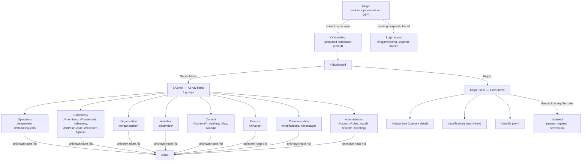
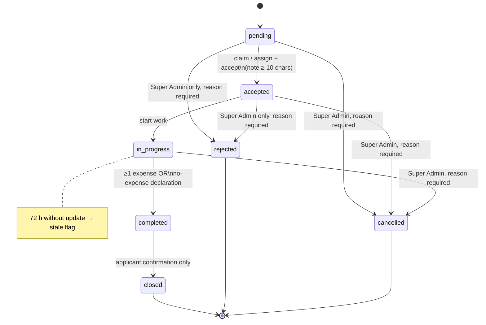

# Satanipara Community — Admin Dashboard User Journeys

Step flows for journeys A–M (audit `AUDIT-BATCH-A.md` §1.4) plus the
Expatriate Helper workflow. Every step names the screen it happens on
(routes per `SCREEN-INVENTORY.md`). Open questions are named per journey
from audit §2 — they are **not resolved here**.

Demo logins: Super Admin `01990000000` / `AdminDemo-2026` (second SA
`01990000002` / `AdminDemo-2026b`); Helper `01990000001` /
`HelperDemo-2026`. All simulated; reload resets state.

## Navigation flow

Role switching is a labelled DEMO control in the topbar user menu
(Super Admin ⇄ Helper). It re-renders the nav and re-runs the route guard;
switching while on a denied route lands on `#/dashboard`. The demo switch
picks the first Super Admin, so it cannot select the second Super Admin —
cross-user approval in one session needs logout + login instead (QA D9).

## State machines

### Expatriate request

Illegal transitions are blocked: `pending → completed`,
`completed → in_progress` (re-opening). Every transition records actor,
from → to, timestamp, note (≥10 chars). A note shorter than 10 chars is
blocked by the form's native `minlength` validation before any modal opens.

### Finance ledger

```mermaid
stateDiagram-v2
    [*] --> draft : new entry
    draft --> draft : field edit\n(id / entry_no / entered_by never change)
    draft --> published : approve & publish\n(approver ≠ enterer)
    draft --> rejected : reject with reason
    draft --> discarded : discard with reason\n(entry_no never reused)
    published --> reversed : reversal approved\n(two steps: create reversal draft,\nthen a different approver publishes it)
    reversed --> [*]
    rejected --> [*]
    discarded --> [*]
    note right of published : published entries are never\nedited or deleted
    note right of reversed : one reversal per original, ever;\na reversal is never itself reversible
```

Approve IS publish — one step, no separate `approved` state. Canonical
transitions only: `draft→draft`, `draft→published`, `draft→discarded`,
`published→reversed`.

### Content (news / notices / events / jobs)

```mermaid
stateDiagram-v2
    [*] --> draft : create
    draft --> review : submit for review
    review --> published : publish
    review --> draft : back to draft
    published --> draft : unpublish
    published --> archived : archive
    draft --> archived : archive
    published --> scheduled : publish_at set
    scheduled --> published : publish_at reached
    note right of review : Phase 1 review is a same-person\ncheckpoint, not second-person approval
    note right of published : editing a published item creates\na NEW revision; the published\nversion stays live until the\nnew revision publishes
```

## Journey A — Admin login

1. Open `#/login`. The login sheet shows the demo credentials under a
   "simulated" heading and a link to the demo states.
2. Enter mobile + password (no OTP anywhere) → submit.
3. Wrong credentials → generic error ("Mobile number or password did not
   match" style), no account-existence oracle. 5 failed attempts locks the
   account (simulated 30 minutes).
4. Correct credentials → first-login onboarding (simulated browser-
   notification permission prompt) → `#/dashboard`.
5. Demo states (from the login screen's link): pending-approval
   (`#/login/pending`), session-expired (`#/login/expired`),
   forced-password-change (`#/login/forced`).

**Open questions:** Q-04/AO-05 (forgot-password mechanism + delivery
channel for temp passwords — the prototype shows Super-Admin-mediated
reset only); AO-01 (15-char passwords for all?); AO-02 (MFA at launch or
optional — settings stub only); Q-20 (language/theme persistence —
session-only in the prototype).

## Journey B — Overview / attention triage

1. SA lands on `#/dashboard`: counts (members, pending approvals, active
   requests, published finance), urgent requests, pending approvals,
   recent audit events, current-year finance summary (published figures
   only, year selectable), system health.
2. Every count is a link to the filtered list (e.g. pending members →
   `#/members?status=pending`).
3. Helper lands on the reduced `#/dashboard`: own queue only (assigned
   requests, pending/urgent/in-progress counts), no finance, members, or
   system figures.

**Open questions:** Q-10 (which statistics are public vs members-only —
settings field is a placeholder); Q-11 (public finance summary level —
publish-summary level selector marked UNDECIDED).

## Journey C — Member approval queue

1. `#/members?status=pending` → pending list (4 demo applicants).
2. `#/members/:id` → detail (masked phone in list, full in detail;
   family tab, request history).
3. Approve → confirm modal naming the member + consequence → member ID
   issued (`MB-2026-XXXX`), login enabled, audited, member notified.
4. Reject → confirm modal + reason ≥10 chars (mandatory, shown to
   applicant). Suspend / reinstate from detail with reason.
5. Duplicate-phone 409 and re-application after rejection are blueprint
   behaviours; the prototype shows the flows, not a live 409.

**Open questions:** AO-17 (phone-number change re-verification by Super
Admin — default REQUIRED; the edit form notes it); AO-11 (anonymise
`payee_bn`/`donor_name_bn` on member deletion — default anonymise,
undecided on the data-rights screen).

## Journey D — Directory & community databank

1. `#/directory` → persons/professionals/institutions (search BN/EN name,
   role, area + category filters). `#/directory?kind=professionals` and
   `?kind=institutions` are sidebar destinations.
2. `#/households` → list; `#/households/:id` → detail with linked persons
   and members (household links verified in QA); `#/households/new` and
   `?edit=1` → create/edit (public visibility requires granted consent —
   blocked with an error otherwise).
3. `#/infrastructure` → landmarks catalogue (list only, no map);
   `#/freedom-fighters` → register.
4. Visibility (`public` / `members-only` / `private`) + consent flags on
   every entry; consent withdrawal hides immediately; DOB never shown
   publicly (age band only); unverified figures show
   "তথ্য হালনাগাদ হচ্ছে".

**Open questions:** Q-10 (visibility defaults); Q-13 (Bengali search
quality — prototype uses the measured FULLTEXT + BOOLEAN MODE approach,
production re-run open); Q-15 (map — list only, no map UI).

## Journey E — Organisation management

1. `#/organisation/history` → milestones (only 1999 is verified; the one
   unverified draft is marked `draft`, never published).
2. `#/organisation/constitution` → versioned constitution (old versions
   retained).
3. `#/organisation/committee` → three tabs: Executive Committee, Advisory
   Council, Former Leaders (one shared person-entry form).
4. `#/organisation/achievements` → timeline entries linked to history.
5. Brand/tagline/slogan + office/contact settings live in `#/settings`.

**Open questions:** Q-06 (real contact details — settings fields ship
with empty-verified states, never pre-filled); Q-08 (logo — text crest
"সা" until a logo exists).

## Journey F — Annual activities

1. `#/activities` → year-grouped list (years derived from data, never
   hard-coded) + mandatory category filter (scholarship, winter clothing,
   blood donation, medical camp, tree plantation, national day, relief,
   other).
2. `#/activities/new` / `#/activities/:id` / `#/activities/:id/edit` →
   create / detail / edit; publish / unpublish / archive; cover + gallery
   images with consent; beneficiary count; linked annual report.
3. `#/activities/categories` → category management;
   `#/activities/archives` → annual archives.
4. Unknown activity ID → designed 404, never a silent fallback.

**Open questions:** Q-16 (unknown activity ID: 404 vs fallback — 404
recommended, pending Fahim); Q-22 (service types 7 vs 6 — same question
family; activity categories are the seeded set).

## Journey G — Expatriate request queue & detail

1. `#/expatriate` → queue: KPIs (pending / active / urgent / stale >72 h),
   search by Request ID/applicant, filters (status/service/urgency/
   assigned/unassigned), stale badge on `in_progress` >72 h.
2. `#/expatriate/:requestNo` → detail: service, for whom, details,
   urgency, applicant (SA always; Helper only when assigned), country,
   Meridian progress (Pending → Accepted → In Progress → Completed →
   Closed), assigned helper, expense ledger with server-computed total,
   constant service charge 0 (no service-charge field anywhere), status
   history with actor/timestamp/note, progress photos with captions.
3. Claim (Helper, unassigned pending) / assign (SA, primary + backup).
4. Transition: pick new status + note ≥10 chars → confirm modal naming
   the request + from → to → applied, audited, toast.
5. Expenses: itemised lines (product cost + transport only) with voucher
   notes; "no expense incurred" declaration as the alternative.
6. Completion gate: ≥1 expense line OR no-expense declaration.
   Closure gate: applicant confirmation only (checkbox on the transition
   form; Helper can never close).
7. Emergency flag + ERT escalation placeholder; 999 disclaimer permanent
   on every expatriate screen ("এই সেবা জরুরি সেবার বিকল্প নয় — আগে ৯৯৯-এ
   কল করুন").

**Open questions:** Q-17/AO-06 (emergency escalation rules + ERT on-call
rotation — flag and notify only, no invented chain); Q-02/AO-18–AO-21
(Tier-S tracking allowlist extras — admin detail shows the full record;
no Tier-S extras in any public preview); Q-03 (guest vs login submission
— admin detail handles guest requests with null account);
**unresolved conflict:** helper-reject — Doc 05 §9.1 allows assigned
helper to reject, Doc 09 §3.9 says Super Admin only. The prototype
follows Doc 09 (no reject action for Helpers). Do not resolve by
guessing.

## Journey H — Blood donor & blood request operations

1. `#/blood/donors` → donor list (group/area/availability filters;
   availability COMPUTED from the 90-day rule, never a static flag).
   A− and AB− are empty — reachable empty states.
2. `#/blood/donors/:id` → detail with consent-to-list record.
3. `#/blood/requests` → list; `#/blood/requests/:id` → detail (group,
   units, hospital, status, per-donor consent outcomes — counts, not
   phone numbers in lists).
4. Ask donor for consent (sends the request, does NOT reveal the number)
   → record grant/revoke → reveal ONLY after grant for that specific
   request, audit-logged.
5. Close request with outcome (fulfilled/cancelled); fulfilled updates
   the donor's last-donation date.

**Open questions:** AO-10 (guest blood-request status checking — no guest
tracking UI in the admin); AO-12 (donor phone destruction period after
withdrawal, recommended 90 days — shown as text, not a working purge).

## Journey I — Content publishing

1. Four lists: `#/content/notices`, `#/content/news`, `#/content/events`,
   `#/content/jobs` (plus `#/content/achievements` for student
   achievements).
2. `#/content/:type/new` → create; `:id` → detail-preview; `:id/edit` →
   edit. Draft → Review → Published (Phase 1 review = same-person
   checkpoint); schedule via `publish_at`; unpublish → draft;
   soft-delete.
3. Notices: priority + expiry (auto-archive at expiry). Jobs: verified
   flag (unverified never public). Events: venue/start/end,
   upcoming/past.
4. Editing a published item creates a NEW revision; the published version
   stays live until the new revision publishes.

**Open questions:** Q-18 (event RSVP — display-only in the admin);
Q-21 (voting rights — copy vs feature; no voting UI anywhere).

## Journey J — Gallery & media library

1. `#/gallery` → grid/list library, albums; `#/media` → media library
   view. Upload (`#/gallery/upload`): file, caption BN/EN, album,
   consent-on-file checkbox REQUIRED for photos of people.
2. Caption/album edit, reorder within album, soft-delete (file retained
   per retention rule, then purged).
3. `#/gallery/video` → Phase 2 placeholder only ("ভিডিও গ্যালারি শীঘ্রই
   আসছে") — no video upload UI, no invented video content.

**Open questions:** AO-14 (media recoverability window, blueprint 30
days); AO-16 (retention periods as policy — figures shown in Settings as
"to be confirmed at handover").

## Journey K — Finance ledger

1. `#/finance` → overview (published figures only, year selectable;
   dashboard preview ৳230,000 for the first 4 rows, full year ৳320,000).
2. `#/finance/ledger` → year-grouped, kind-filtered list;
   `#/finance/new` → entry form (date, item, kind, category,
   project/activity link, amount BDT, payee, voucher).
3. `#/finance/:entryNo` → detail; draft edit (`/edit`) — `id` /
   `entry_no` / `entered_by` never change.
4. `#/finance/pending` → approve-and-publish in ONE step (approver ≠
   enterer; self-approval refused with the rule named and the button
   disabled) / reject with reason / discard draft with reason.
5. `#/finance/:entryNo/reverse` → reversal draft (amount is the opposite
   of the original, automatic) → a different approver publishes it →
   original becomes `reversed`. One reversal per original, ever; a
   reversal is never itself reversible.
6. `#/finance/projects` → project accounts (spent COMPUTED from the
   ledger — linked published expense entries only); `#/finance/categories`
   → categories; `#/finance/summaries` → monthly summaries computed on
   read ("as of now"); `#/finance/reports` → annual reports (prepare
   draft → another SA approves → published; audited flag shown).

**Open questions:** Q-11 (public finance summary level — level selector
marked UNDECIDED; dual control itself is decided); AO-08
(single-approver finance exception — policy document only, NEVER a code
path; the prototype shows the blocked state + one-admin warning banner).

## Journey L — Notifications, contact messages & reports

1. `#/notifications` → own inbox (mark read / mark all read / clear own;
   type + related-record deep-link). Each admin sees only their own inbox.
2. `#/notifications/log` → delivery log (Super Admin only). Derived from
   inbox rows + the routing rule (labelled on screen); a new request
   notifies the Super Admin + all Helpers, urgent also the backup helper.
3. `#/messages` → contact-message inbox; `#/messages/:id` → detail +
   reply ≥10 chars (stored as the record, conveyed out of band in Phase
   1 — no email provider); mark resolved.
4. `#/reports` → Reports & Analytics — **not built** (see
   `SCREEN-INVENTORY.md` #44). Date-range summaries, per-module
   breakdowns, export CSV are specified but have no screen yet.

**Open questions:** Q-14 (Reverb driver for realtime notifications —
prototype simulates with toast + bell badge, labelled simulated);
AO-13 (notifications_log cold storage after 2 years).

## Journey M — Users, roles, audit & settings

1. `#/users` → list (masked phone); `#/users/new` → create (name/phone/
   password 12-min, 16-min Super Admin, breach screening; role = one of
   the two Phase 1 roles); `#/users/:id` → detail (password reset via
   system-generated single-use temp password ≥16 chars, 24 h expiry,
   shown ONCE in a drawer; role history); `#/users/:id/edit` → edit /
   deactivate-reactivate.
2. Role assign: self-removal banned; last-Super-Admin guard blocks
   demoting/suspending the last active Super Admin (button disabled with
   the reason shown).
3. `#/roles` → view-only matrix (roles seeded by deployment; no UI
   create/edit). `#/audit` → view + filter only (actor/action/target/
   old→new/IP/timestamp Asia-Dhaka; no edit/delete; action codes shown
   as log identifiers). `#/audit/:id` → entry detail.
4. `#/settings` → grouped form (brand & identity, contact & office,
   policy copy incl. no-service-charge statement + 999 disclaimer + ERT
   size, system). Every change audited with old→new values.
5. `#/health` → queue status + last successful backup (demo values).
   `#/data-rights` → access/correction/deletion queue (30-day grace).

**Open questions:** AO-07 (who authorises a recovery bootstrap, by
office — runbook item, no recovery UI); AO-09 (CAPTCHA provider — none
in Phase 1, no CAPTCHA UI); AO-15 (purge of former-member records —
currently none); Q-24/Q-25/Q-27 (UAT testers, primary data owner,
hosting/handover ownership — no screen impact).

## Helper workflow (end to end)

1. Log in as Helper → reduced `#/dashboard` shows only "আমার সারি"
   (own queue): assigned requests with pending / urgent / in-progress
   counts.
2. `#/expatriate` → full queue (all requests, all statuses) with the
   same filters as the SA queue; applicant contact visible only for
   assigned requests.
3. Claim an unassigned pending request → it becomes assigned to the
   Helper; or accept a request assigned to them (`pending → accepted`).
4. Advance only assigned requests: `accepted → in_progress →
   completed`, note ≥10 chars on every transition; add update notes +
   photos; add itemised expenses or declare no expense.
5. Mark `completed` (closure is the applicant's act — the Helper requests
   closure, never closes). No reject action exists for Helpers.
6. `#/notifications` → own inbox only; `#/profile` → own profile, edit
   own details, change own password.
7. Any deep-link to a Super Admin route (`#/finance`, `#/members`,
   `#/users`, `#/settings`, `#/audit`, `#/blood/requests`,
   `#/content/news`, …) → `#/denied` screen naming the required
   permission.
