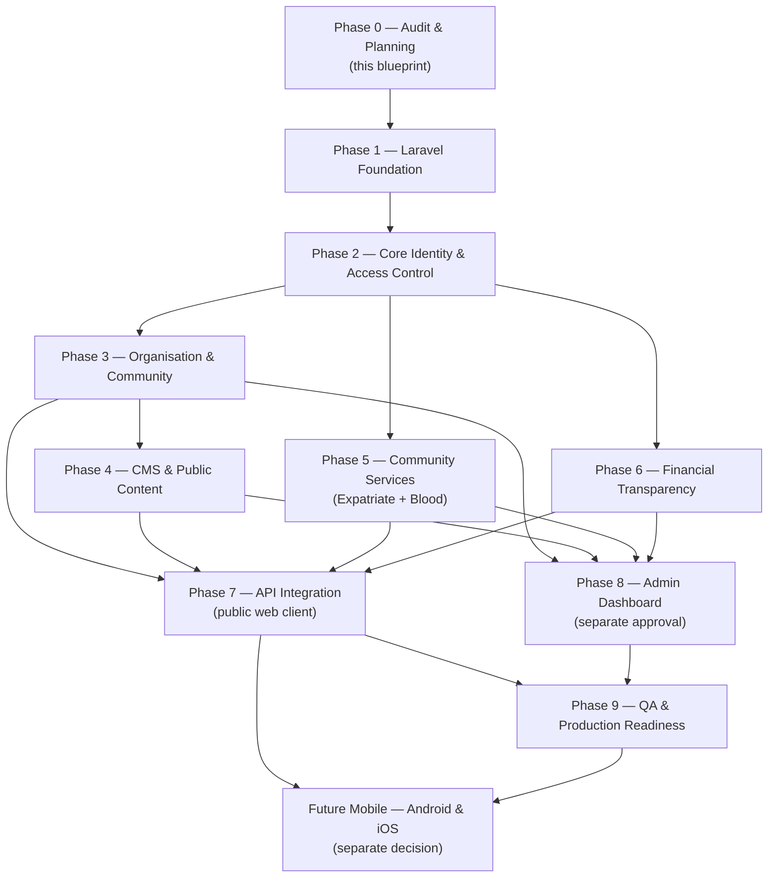

# 12 — Development Roadmap

| | |
|---|---|
| Document | Satanipara Community — Phase 0 Backend Blueprint, Doc 12 |
| Status | **Planned** — planning only; no development has started |
| Sources | Decision Sheet (single source of truth); Audit Findings; Research Notes (verified 2026-11-14); Engineering Plan v1.1 |
| Companion docs | Docs 07–11, ADRs 001–013, diagrams |

> **Dates and estimates.** This roadmap contains **no invented dates**. The only time figures in it are the Engineering Plan v1.1 estimates — **website ~12 weeks, with apps ~18 weeks** — and they are repeated here explicitly as **plan estimates, not commitments**. They are estimates pending client data and approval: real member data, real committee lists, real finance records, verified contact details, and the organisation's decisions on the open items in Doc 07 §17 all affect the real schedule, and none of those inputs exists yet. A phase's completion is defined by its acceptance criteria (§2 per phase), not by a calendar date.

> **How this roadmap relates to the directive's Phase 0–9 + mobile phases.** The directive's phases are revised here by dependency: each phase starts only when its dependencies are met, and the order follows what must exist before something else can be built on it. The most important revision is that the **admin dashboard (Phase 8) comes after the API and the services it administers**, and that **QA & Production Readiness (Phase 9) is a phase in its own right**, not a final week of tidying. Phase numbering is kept (0–9 + Future Mobile) so it can be traced back to the directive.

## 1. Dependency graph

In words first, then Mermaid. The graph reads top-to-bottom: a phase depends on everything above it that it names.

- **Phase 0** (this blueprint) depends on nothing except the audit, the research, and the decision sheet — all of which exist.
- **Phase 1** (Laravel Foundation) depends on Phase 0 and on the scaffold-time version checks (ADR-001–ADR-003).
- **Phase 2** (Core Identity & Access Control) depends on Phase 1. Everything else that has a user depends on Phase 2.
- **Phase 3** (Organisation & Community) depends on Phase 2 (permissions) and Phase 1 (media storage for photos).
- **Phase 4** (CMS & Public Content) depends on Phase 2 and Phase 3 (activities belong to the organisation's public presence; content publishing uses the same workflow).
- **Phase 5** (Community Services: expatriate + blood) depends on Phase 2 (members, helpers, notifications) and Phase 1 (queue for notifications). It is the largest phase and the one the organisation will judge the system by.
- **Phase 6** (Financial Transparency) depends on Phase 2 (Super Admin-only permissions). It is independent of Phases 3–5 and can run in parallel with them once Phase 2 is done.
- **Phase 7** (API Integration: public web client against the API) depends on Phases 3–6 (there must be real API content to integrate) and on the Direction D frontend work, which is a separate track.
- **Phase 8** (Admin Dashboard) depends on Phases 2–6 (it administers what those phases built) and on **separate approval** — it does not start on the strength of this roadmap alone.
- **Phase 9** (QA & Production Readiness) depends on all of Phases 1–8 that were approved and built. It is not skippable.
- **Future Mobile** (Android & iOS) depends on Phases 1–7 (the API must be stable and versioned) and on a separate decision and budget.

**Parallelism note.** Phases 3, 4, 5, and 6 share only Phase 2 as a dependency. Once Phase 2 is complete, they can proceed in parallel (subject to team size) in the order the organisation values most — the recommended order is 5, then 6, then 3, then 4, because the expatriate service is the organisation's most distinctive workflow and the one with the most untested assumptions. Phase 7 cannot start until the API surface it integrates is stable.

## 2. Phases

### Phase 0 — Audit & Planning (this document set)

- **Scope:** forensic audit of the prototype repository (37 features, demo-data catalogue, validation rules, gaps); verified technology research (Laravel 13, PHP 8.4/8.5, Sanctum 4.x, Filament 5.x, Spatie Permission v8, PostgreSQL, database queue/cache, Scout database engine, spatie/laravel-backup v10); decision sheet; this blueprint (Docs 07–12, ADRs 001–013, architecture diagrams).
- **Deliverables:** `audit-findings.md`, `research-notes.md`, `decision-sheet.md`, Docs 07–12, 13 ADRs, 2 diagram documents.
- **Dependencies:** the prototype repository and the Engineering Plan v1.1 (both existed).
- **Risks:** decisions recorded here that turn out to be wrong at scaffold time (e.g. a package version that has moved). Mitigation: every ADR records its status honestly and every version is re-checked at scaffold time (Research Notes §9).
- **Testing requirements:** none — this phase produces documents, not code. Its quality bar is traceability: every claim cites the audit, the research, or the plan.
- **Acceptance criteria:** the decision sheet is accepted as the single source of truth; the blueprint is complete enough for another team to implement without guessing; no dates, prices, stats, or people are invented anywhere in it.
- **Completion conditions:** all documents listed above exist and are internally consistent; the open decisions (Doc 07 §17, Doc 08 §14, Doc 11 §11) are listed, not hidden. **Status: done in this document set.**

### Phase 1 — Laravel Foundation

- **Scope:** scaffold the Laravel 13 application (`^13.0`, PHP 8.4 or 8.5); PostgreSQL connection; Sanctum installed; Spatie Permission installed; Filament installed (panel skeleton only — no resources yet); database queue + database cache + database sessions; Scout database engine; local media disks via the Storage facade; spatie/laravel-backup installed with the nightly schedule; Pint + Larastan + Pest/PHPUnit wired into CI; GitHub Actions pipeline with the gates in Doc 10 §9; staging environment provisioned as a production copy (Doc 11 §1).
- **Deliverables:** a running skeleton application on staging with a health endpoint, login page (Filament), and a passing empty test suite; the CI pipeline green; the backup job running and its first restore test performed.
- **Dependencies:** Phase 0; scaffold-time version checks (Packagist for Laravel/Sanctum/Filament/Spatie Permission/backup — Research Notes §9); VPS access and the organisation's domain decision (or a staging hostname).
- **Risks:** a chosen package version is incompatible with Laravel 13 at scaffold time (mitigation: re-check and record the resolved versions in the ADRs); the VPS cannot be reached (mitigation: the documented fallback of preparing a self-contained script — see the workspace's standing notes on VPS access).
- **Testing requirements:** the CI gates run on an empty suite and pass; the health endpoint reports database/queue/cache/storage; the first backup restores successfully to a disposable environment.
- **Acceptance criteria:** `main` is green in CI; staging serves the health endpoint; a backup exists off-server and has been restored once; no demo data is seeded as if it were real.
- **Completion conditions:** all of the above, plus the resolved package versions recorded in the ADRs.

### Phase 2 — Core Identity & Access Control

- **Scope:** M1 (Identity & Membership). Member registration (pending-application workflow), login (Sanctum cookie for web, tokens for future mobile), logout/logout-all, password change, Super Admin password reset, member approval/rejection with member IDs, profile view/edit (with server-side validation — the prototype validated nothing), the two Phase 1 roles (`super-admin`, `expatriate-helper`) with the full permission set in Doc 07 §14, the authorisation test matrix (Doc 10 §5) for every endpoint built in this phase, phone encryption + `phone_hash` (Doc 08 §6.2), login rate limiting and lockout, audit logging for auth events.
- **Deliverables:** the Auth and Member endpoints in Doc 07 §14.1 and §14.11; the permission seeder; the admin user-creation flow (Doc 07 D4–D5).
- **Dependencies:** Phase 1.
- **Risks:** the phone-number format rule (Bangladesh mobile) is wrong for some real members (mitigation: confirm the rule with the organisation's real data sample in Sprint 1); the "no OTP" scope is misunderstood as "no account recovery" (mitigation: the Super Admin reset flow is built and demonstrated in UAT).
- **Testing requirements:** the full auth and authorisation test suites (Doc 10 §4.2, §5); the brute-force/lockout tests (Doc 10 §7); UAT with 2–3 client testers on staging.
- **Acceptance criteria:** a member can register, be approved, log in, and edit their profile; an unapproved applicant cannot log in; a helper cannot reach any non-expatriate endpoint (proven by the matrix, not by assertion); the audit log records logins, approvals, and resets.
- **Completion conditions:** acceptance criteria met + UAT sign-off for the phase.

### Phase 3 — Organisation & Community

- **Scope:** M2 (Community Profile) and M3 (Organisation). Public directory (search/filter, consent-gated publication), organisation history (verified milestones only — 1999 is the only verified milestone), constitution versioning, committee/advisory/former-leader management, public stats with the "updating" state for unverified figures, infrastructure records (proposed — confirm in Sprint 1).
- **Deliverables:** the endpoints in Doc 07 §14.3 and §14.4.
- **Dependencies:** Phase 2 (permissions); Phase 1 (media storage for committee photos).
- **Risks:** real data arrives late or unverified (mitigation: the system ships with the "updating" state, never with invented figures — Decision Sheet); a committee member withdraws consent for a photo (mitigation: consent flags are per item and revocable).
- **Testing requirements:** directory search/filter tests; consent-gating tests (an entry without consent is never public); history verification-flag tests; the authorisation matrix for the new endpoints.
- **Acceptance criteria:** the public directory, history, constitution, and committee pages render from the API with real (consented) data or honest "updating" placeholders; no demo person appears as real.
- **Completion conditions:** acceptance criteria met + UAT sign-off.

### Phase 4 — CMS & Public Content

- **Scope:** M4 (Annual Activities) and M7 (Content). Activities with mandatory categories, news, notices (priority + expiry), events, jobs (verification flag), gallery (consent-gated uploads), FAQ, video gallery (proposed — confirm in Sprint 1), and the draft → publish workflow for all of it.
- **Deliverables:** the endpoints in Doc 07 §14.5 and §14.6.
- **Dependencies:** Phase 2; Phase 3 (activities are presented alongside the organisation's public presence).
- **Risks:** content volume is higher than expected and the publishing workflow becomes a bottleneck (mitigation: the workflow is deliberately simple in Phase 1 — one publisher — and a review step is a future change request); video scope is undecided (mitigation: the video endpoints stay "proposed" until Sprint 1 confirms them).
- **Testing requirements:** the content lifecycle tests (Doc 10 §4.5); upload tests (Doc 10 §3); the authorisation matrix.
- **Acceptance criteria:** every public content type can be created as a draft, published, unpublished, and soft-deleted; nothing unpublished is visible publicly; an activity cannot be created without a category; a job cannot be published unverified.
- **Completion conditions:** acceptance criteria met + UAT sign-off.

### Phase 5 — Community Services (Expatriate Support + Blood)

- **Scope:** M5 (Expatriate Support) and M6 (Blood Donor), plus M9 (Notifications) as far as it serves these two services. The expatriate request lifecycle with its state machine, assignment, expenses with receipts, public tracking with the confirmed privacy boundary, helper notifications on new requests; the blood-donor directory, blood requests, matching-donor notification, and the donor-side consent flow with audited phone reveals.
- **Deliverables:** the endpoints in Doc 07 §14.7, §14.8, and §14.10.
- **Dependencies:** Phase 2 (members, helpers, notifications); Phase 1 (queue for notification delivery).
- **Risks:** the public-tracking privacy boundary is decided wrong (mitigation: it is a Sprint 1 decision, recorded, and changeable before go-live); donors do not engage with the consent flow (mitigation: the flow is tested in UAT with real donors before go-live, and the fallback — office-mediated consent — is defined); the D11 wizard step-count mismatch (3 built vs 4 specified) is unresolved (mitigation: it is recorded as open in Doc 07 §17 and must be confirmed before the web client is built against the API).
- **Testing requirements:** the full workflow suites in Doc 10 §4.1 and §4.3 (every valid and every invalid transition; the consent lifecycle; the D3 regression test); the E2E journeys in Doc 10 §6 (request submit → helper notification; tracking; blood search); UAT with real helpers.
- **Acceptance criteria:** a request can be submitted publicly, appears in the helper queue, is claimed, advanced through every valid status with notes, accumulates expenses totalling correctly, and closes; an invalid transition is rejected; a donor's phone is never revealed without that donor's grant for that request; every step is in the audit log.
- **Completion conditions:** acceptance criteria met + UAT sign-off, including a UAT run by at least one real helper.

### Phase 6 — Financial Transparency

- **Scope:** M8 (Finance). Ledger entries (draft → approve → publish), reversal-only corrections, public ledger and totals, annual-report publication (real PDF files, versioned by year), finance summary for admins, project accounts (proposed — confirm in Sprint 1).
- **Deliverables:** the endpoints in Doc 07 §14.9.
- **Dependencies:** Phase 2 (Super Admin-only permissions). Independent of Phases 3–5; can run in parallel with them.
- **Risks:** real finance records arrive in a form that does not match the ledger model (mitigation: the data-migration rehearsal in Phase 9 validates the shape before go-live); dual control (separate approver) is wanted but was not decided (mitigation: the decision is a Sprint 1 item, Doc 07 §17, and the code is written so the check can be added without restructuring).
- **Testing requirements:** the finance lifecycle tests (Doc 10 §4.4), including the exact-arithmetic regression using the prototype's demo figures as a fixture; the authorisation matrix.
- **Acceptance criteria:** an entry can be created, approved, published, and reversed (with reason); a published entry cannot be edited or deleted; public totals equal the sum of published entries; a reversal is visible and linked.
- **Completion conditions:** acceptance criteria met + UAT sign-off.

### Phase 7 — API Integration (public web client)

- **Scope:** M11 (Public Web Experience). The Next.js public website built against the `/api/v1` API defined in this blueprint, following the Direction D design tokens and the Meridian system (Decision Sheet). All 18 prototype routes re-implemented against real API data; the expatriate wizard (step count per the D11 confirmation); tracking; blood search with the consent flow; finance pages; BN/EN language; light/dark themes with persistence decided explicitly (the prototype was session-only — Audit Findings §6 — and the production behaviour must be a decision, not an accident).
- **Deliverables:** the public website on staging, consuming only the documented API; no page that reads demo data from a local constant.
- **Dependencies:** Phases 3–6 (real API content must exist); the D11 confirmation; the Direction D frontend direction (which is a separate track from this backend blueprint — this blueprint does not redesign Direction D).
- **Risks:** the API and the frontend drift (mitigation: contract tests, Doc 10 §3, run in CI against the staging API); the frontend needs an endpoint the API does not have (mitigation: the gap is a Change Request, not a quiet addition).
- **Testing requirements:** the Playwright E2E journeys (Doc 10 §6); Lighthouse budgets (Doc 10 §8); the contract suite.
- **Acceptance criteria:** every prototype route works against the API; no page contains hardcoded demo data; the performance budgets are met on staging.
- **Completion conditions:** acceptance criteria met + UAT sign-off on staging, including a check on a real phone (the prototype's real-device check was never done — Audit Findings §8 item 15).

### Phase 8 — Admin Dashboard (after separate approval)

- **Scope:** M10 (Admin & Reporting). The Filament 5 admin panel implementing Doc 09 in full: overview, users, roles/permissions (view), members, organisation, committee, content, activities, expatriate operations, blood operations, finance, gallery/media, reports/analytics, notifications, contact messages, audit logs, settings.
- **Deliverables:** the admin panel on staging, behind the same auth and the same policies as the API.
- **Dependencies:** Phases 2–6 (it administers what those phases built); **separate approval** — this phase does not start on the strength of this roadmap alone.
- **Risks:** the panel is treated as "just CRUD" and the permission boundaries are weakened for convenience (mitigation: the authorisation matrix covers the panel's routes as well as the API's; a helper opening the panel sees only expatriate operations — proven by test, not by menu hiding).
- **Testing requirements:** the authorisation matrix extended to panel routes; the module behaviours in Doc 09 §3 (including empty/loading/error states); UAT with the real Super Admin and at least one real helper.
- **Acceptance criteria:** every module in Doc 09 behaves as specified; a helper sees only expatriate operations; every consequential action is confirmed and audited.
- **Completion conditions:** acceptance criteria met + UAT sign-off + the separate approval recorded.

### Phase 9 — QA & Production Readiness

- **Scope:** the whole system, end to end. Full regression run; performance testing against the budgets (Doc 10 §8) with a realistic dataset; security review against Doc 08 §13 (the acceptance list); backup restore rehearsal (Doc 11 §6); data-migration rehearsal with real data (if the organisation supplies it); accessibility pass (keyboard, screen reader, reduced motion — the prototype never had one, Audit Findings §8 item 15); real-device checks (Safari/Firefox/Android, real phones); incident-response outline (Doc 08 §12) turned into a named contact and a practiced run-through; runbook written; handover checklist (Doc 11 §10) executed.
- **Deliverables:** a release candidate on staging that passes every gate; the runbook; the handover pack; the go-live decision recorded in writing.
- **Dependencies:** all approved phases (1–8) complete.
- **Risks:** a late-found security or performance issue delays go-live (mitigation: that is the phase working as designed — go-live moves, the issue does not ship); real data is not ready (mitigation: go-live with honest "updating" placeholders is acceptable and is the designed behaviour, not a failure).
- **Testing requirements:** everything in Doc 10, run in full, plus the UAT sign-off for the release as a whole.
- **Acceptance criteria:** Doc 08 §13 (all six items true); Doc 10 §8 budgets met or explicitly waived in writing with a reason; a restore rehearsal passed within the quarter; the handover checklist complete.
- **Completion conditions:** written go-live approval from the organisation; production deploy performed per Doc 11 §4.3 with a pre-deploy backup; the first monthly health report scheduled.

### Future Mobile — Android & iOS

- **Scope:** M12 (Mobile App). Flutter apps for Android and iOS consuming the same `/api/v1` API with Sanctum personal access tokens (Doc 07 §8.2), FCM/APNs device registration (Doc 07 §12), and the member-facing journeys (login, requests, tracking, blood search, notifications).
- **Deliverables:** the two apps, distributed through the normal store/test channels.
- **Dependencies:** Phases 1–7 (a stable, versioned API); a separate decision and budget. The plan estimate for the programme **with apps is ~18 weeks** (Engineering Plan v1.1) — a plan estimate, not a commitment.
- **Risks:** the API needs a mobile-only change (mitigation: additive changes inside v1, per Doc 07 §13); push delivery is unreliable on a device (mitigation: the database notification is the reliable record — Doc 07 §12).
- **Testing requirements:** the API contract suite extended for mobile clients; device testing on real Android and iOS hardware; the E2E journeys re-run through the app.
- **Acceptance criteria:** the app performs the member journeys against the production API; token expiry and logout-all behave as specified; push notifications arrive for a new request (helper) and a status change (member).
- **Completion conditions:** store/test-channel release + UAT sign-off by the organisation.

## 3. Estimates — what they are and what they are not

| Figure | Source | Status |
|---|---|---|
| Website ~12 weeks | Engineering Plan v1.1 | **Plan estimate, not a commitment.** Pending client data + approval |
| With apps ~18 weeks | Engineering Plan v1.1 | **Plan estimate, not a commitment.** Pending client data + approval |

No per-phase durations are given in this blueprint, because no per-phase estimate exists in the sources and inventing one would be false precision. Per-phase durations are set when each phase starts, based on the team, the confirmed scope, and the data the organisation has supplied by then — and are recorded as estimates, not promises.

## 4. Risks across the programme

| Risk | Impact | Mitigation |
|---|---|---|
| Real data (members, committee, finance, photos) arrives late or unverified | Public pages show "updating" placeholders longer than hoped | The system is designed for this (Decision Sheet); it is not a failure state |
| An open decision (Doc 07 §17) is left undecided into the phase that needs it | Rework, or a guessed answer baked into code | Sprint 1 confirms the list; a phase does not start with its decisions open |
| VPS access is intermittent (the standing workspace notes record repeated SSH resets) | Deploys and staging provisioning stall | The documented fallback (self-contained script run by Fahim on the VPS) is used; no turn is spent retrying a dead route |
| A package version moves at scaffold time | An ADR's version claim becomes stale | Versions are re-checked at scaffold and the ADR is updated with the resolved version |
| Scope creep (a new feature requested mid-phase) | Schedule and quality suffer | Change Requests (Doc 11 §8); nothing ships without written approval |
| The two-role constraint is misunderstood and a third role is built | Phase 1 scope is broken; the permission model must be reworked | The constraint is stated in the Decision Sheet, in Doc 07, in Doc 09, and in the acceptance criteria of every phase |
| Security is treated as a Phase 9 activity | Vulnerabilities are baked in and expensive to remove | Security controls are built per phase (Doc 08) and tested per phase (Doc 10 §7); Phase 9 verifies, it does not invent |
