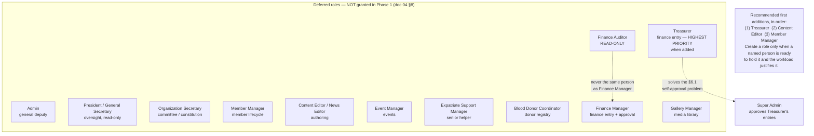

# Role–Permission Matrix

| | |
|---|---|
| **Document** | Satanipara Community — Phase 0 Backend Blueprint, diagrams/RBAC-MATRIX.md |
| **Status** | Planned — not yet implemented. |
| **Sources** | `04-USER-ROLES-PERMISSIONS.md` (authoritative — this matrix must match it exactly); Decision Sheet; Engineering Plan v1.1 §5 |
| **Rule** | Permission names here are exactly those in doc 04 §4. Grants here are exactly those in doc 04 §§2, 6, 7, 8. If this document disagrees with doc 04, doc 04 governs and the discrepancy must be reported to the coordinator. |

---

## 1. How to read this matrix

**Symbols:**

| Symbol | Meaning |
|---|---|
| `✓` | Granted to that role in Phase 1. |
| `—` | Not granted. The system denies it (403, or 404 where the record is outside the caller's ownership scope — doc 04 §7.5). |
| `◐` | **Conditional** — granted, but only within the scope stated in the Notes column. The condition is enforced by a policy, not by the frontend. |
| `F` | **Future** — belongs to a deferred role (§4). Not granted to anyone in Phase 1. |

**Columns (Phase 1):**

| Column | Role | Nature |
|---|---|---|
| **SA** | Super Admin (`super-admin`) | Admin. Full administration, except the two limits in doc 04 §9: never approves their own finance entries (§6.1), and can never remove the last active Super Admin (§3.2). |
| **EH** | Expatriate Helper (`expatriate-helper`) | Admin, M5 only. |
| **MB** | Member (`member`) | Registered, approved community user. Not an admin role. Own data only. |
| **PB** | Public Visitor (`public`) | Unauthenticated. Published public content only. |

**Deny by default** (doc 04 §1.3): anything not explicitly granted is denied. No permission is implied by another, and no role inherits from another.

---

## 2. Mermaid diagram — Phase 1 roles and their permission groups

The diagram below is a summary view: each role node links to the permission groups it holds. The **tables in §3 are authoritative** — the diagram is a picture of the same grants, not a second source.

```mermaid
flowchart TD
    subgraph Phase1["Phase 1 — granted roles"]
        SA["Super Admin<br/>super-admin<br/>Everything, except:<br/>• never approves own finance entries<br/>• never removes the last Super Admin"]
        EH["Expatriate Helper<br/>expatriate-helper<br/>M5 only"]
        MB["Member<br/>member<br/>Own data only"]
        PB["Public Visitor<br/>public<br/>Published public content only"]
    end

    subgraph Groups["Permission groups (doc 04 §4)"]
        G_ID["Identity & membership (M1)<br/>members.* / profile.* / families.*"]
        G_DIR["Community & directory (M2)<br/>directory.* / community.*"]
        G_ORG["Organisation (M3)<br/>organisation.* / constitution.* / committee.*"]
        G_ACT["Activities (M4)<br/>activities.*"]
        G_EXP["Expatriate support (M5)<br/>expatriate.*"]
        G_BLD["Blood donor (M6)<br/>donors.* / blood.*"]
        G_CON["Content (M7)<br/>content.* / media.* / reports.*"]
        G_FIN["Finance (M8)<br/>finance.*"]
        G_NOT["Notifications (M9)<br/>notifications.*"]
        G_ADM["Admin & system (M10)<br/>dashboard.* / audit_logs.* / roles.*<br/>settings.* / contact_messages.*<br/>data_rights.* / system.*"]
    end

    SA --> G_ID
    SA --> G_DIR
    SA --> G_ORG
    SA --> G_ACT
    SA --> G_EXP
    SA --> G_BLD
    SA --> G_CON
    SA --> G_FIN
    SA --> G_NOT
    SA --> G_ADM

    EH --> G_EXP
    EH -.->|"view-only<br/>public + members-only"| G_DIR
    EH -.->|"view-only<br/>masked search"| G_BLD
    EH -.->|"view-only<br/>published"| G_CON
    EH -.->|"own profile<br/>own notifications"| G_ID
    EH -.->|"own notifications"| G_NOT

    MB -.->|"own record only"| G_ID
    MB -.->|"view-only<br/>public + members-only"| G_DIR
    MB -.->|"view-only"| G_ORG
    MB -.->|"view-only"| G_ACT
    MB -.->|"own requests only"| G_EXP
    MB -.->|"own donor record<br/>+ masked search"| G_BLD
    MB -.->|"view-only<br/>published"| G_CON
    MB -.->|"published summaries only"| G_FIN
    MB -.->|"own notifications"| G_NOT

    PB -.->|"view-only<br/>public visibility only"| G_DIR
    PB -.->|"view-only"| G_ORG
    PB -.->|"view-only"| G_ACT
    PB -.->|"submit + track by ID<br/>status only"| G_EXP
    PB -.->|"submit + masked search"| G_BLD
    PB -.->|"view-only<br/>published"| G_CON
    PB -.->|"published summaries only"| G_FIN
```

**Reading the diagram:** a solid arrow (`-->`) means the role holds the group's write permissions (subject to the conditions in §3). A dotted arrow (`-.->`) means the role holds only the read/own-scope subset labelled on the arrow. A role with no arrow to a group holds nothing in that group.

---

## 3. Complete Role–Permission Matrix (Phase 1)

This is the authoritative matrix. Every permission is from doc 04 §4.2. Every grant matches doc 04 §§2, 6, 7, 8.

### 3.1 Identity & membership (M1)

| Permission | SA | EH | MB | PB | Notes |
|---|---|---|---|---|---|
| `members.view` | ✓ | — | — | — | Admin view incl. PII. Members see only their own record via `profile.view_own`. |
| `members.create` | ✓ | — | — | — | Super Admin creates users. Public self-registration is a public endpoint governed by its own validation/rate-limit, not by this permission (doc 04 §4.2). |
| `members.update` | ✓ | — | — | — | Any member's record. |
| `members.approve` | ✓ | — | — | — | Approve/reject pending registrations. |
| `members.suspend` | ✓ | — | — | — | Suspend/reinstate. Revokes tokens + sessions immediately. |
| `members.delete` | ✓ | — | — | — | Soft-delete only; anonymise where finance/request records exist (doc 06 §11.5). Last-Super-Admin guard applies (doc 04 §3.2). |
| `members.export` | ✓ | — | — | — | Confirmation-gated + audit-logged (doc 04 §§5.6, 7.2). |
| `members.reset_password` | ✓ | — | — | — | Super-Admin-mediated reset (doc 04 §5.5). A user cannot reset their own password this way. |
| `profile.view_own` | ✓ | ✓ | ✓ | — | Own profile. SA/EH hold it as users in their own right. |
| `profile.update_own` | ✓ | ✓ | ✓ | — | Own profile. |
| `families.manage_own` | ✓ | ✓ | ✓ | — | Own family records. |

### 3.2 Community profile & directory (M2)

| Permission | SA | EH | MB | PB | Notes |
|---|---|---|---|---|---|
| `directory.view` | ✓ | ◐ | ◐ | ◐ | SA: all visibilities. EH/MB: `public` + `members-only`. PB: `public` only. Enforced by a query scope (doc 04 §7.1). |
| `directory.create` | ✓ | — | — | — | |
| `directory.update` | ✓ | — | — | — | |
| `directory.delete` | ✓ | — | — | — | Soft-delete. |
| `directory.publish` | ✓ | — | — | — | Mark public / withdraw. Consent must be recorded first (doc 04 §7.2). |
| `community.stats.view` | ✓ | ✓ | ✓ | ✓ | Computed aggregates only (doc 06 §9.1). "Updating" state while data is unverified. |
| `community.infrastructure.view` | ✓ | — | ◐ | ◐ | Reserved: the infrastructure feature has no data in Phase 1 (doc 06 §3.8). MB/PB see published facilities only, when the module exists. |
| `community.infrastructure.manage` | ✓ | — | — | — | Reserved: Super Admin only, when the module exists. |

### 3.3 Organisation (M3)

| Permission | SA | EH | MB | PB | Notes |
|---|---|---|---|---|---|
| `organisation.view` | ✓ | — | — | — | Admin-side view. Public/org pages are covered by `content.view_public`. |
| `organisation.update` | ✓ | — | — | — | Profile, history, mission/vision. |
| `organisation.timeline.manage` | ✓ | — | — | — | Milestones; `is_verified` required to publish (only 1999 is verified today). |
| `constitution.view` | ✓ | ✓ | ✓ | ✓ | Summary + full text per organisation decision. |
| `constitution.manage` | ✓ | — | — | — | Versions, articles, document upload. |
| `committee.view` | ✓ | ✓ | ✓ | ✓ | Public listing (with consent). |
| `committee.manage` | ✓ | — | — | — | Terms, members, advisors, past leaders. |

### 3.4 Annual activities (M4)

| Permission | SA | EH | MB | PB | Notes |
|---|---|---|---|---|---|
| `activities.view` | ✓ | ✓ | ✓ | ✓ | Public side covered by `content.view_public`; this is the admin-side view, and all roles may view published activities. |
| `activities.create` | ✓ | — | — | — | Year + category stored per activity. |
| `activities.update` | ✓ | — | — | — | |
| `activities.delete` | ✓ | — | — | — | Soft-delete. |
| `activities.publish` | ✓ | — | — | — | Publish / unpublish. |

### 3.5 Expatriate support (M5)

| Permission | SA | EH | MB | PB | Notes |
|---|---|---|---|---|---|
| `expatriate.requests.view` | ✓ | ✓ | — | — | Full queue + any detail. MB uses `view_own`; PB uses `track`. |
| `expatriate.requests.view_own` | ✓ | — | ✓ | — | Own requests only (MB). |
| `expatriate.requests.create` | ✓ | ✓ | ✓ | ✓ | Public submission, no login required (doc 04 §2.4). |
| `expatriate.requests.assign` | ✓ | ◐ | — | — | SA: assign any helper. EH: self-assign an unassigned pending request only. |
| `expatriate.requests.accept` | ✓ | ✓ | — | — | EH: only a request assigned to them (or one they just took). |
| `expatriate.requests.advance` | ✓ | ◐ | — | — | EH: only an assigned request, one legal step at a time (doc 05 §9.1). |
| `expatriate.requests.reject` | ✓ | ◐ | — | — | EH: only an assigned request, reason mandatory. |
| `expatriate.requests.cancel` | ✓ | — | ◐ | — | SA: any, with reason. MB: own requests only. |
| `expatriate.requests.close` | ✓ | — | ◐ | — | Closure is the applicant's act (MB, own requests) or SA after confirmation received out of band. EH cannot close. |
| `expatriate.requests.update` | ✓ | — | — | — | Edit core fields (service, beneficiary, details, urgency). SA only; helpers edit via updates/expenses. |
| `expatriate.updates.create` | ✓ | ◐ | — | — | EH: only on an assigned request. |
| `expatriate.expenses.create` | ✓ | ◐ | — | — | EH: only on an assigned request. No service-charge field exists. |
| `expatriate.expenses.view` | ✓ | ✓ | ◐ | — | EH: on requests they may view. MB: on own requests. |
| `expatriate.track` | ✓ | ✓ | ✓ | ✓ | Public tracking by Request ID + 128-bit tracking secret (POST only) — request_no, status, service snapshot, 4-node timeline with visible notes, expense lines + total, service charge 0; no applicant/beneficiary identity, no details, no vouchers, no photos (Doc 04 §7.4). |
| `expatriate.emergency.manage` | ✓ | — | — | — | ERT roster (3–5). SA only. |

### 3.6 Blood donor (M6)

| Permission | SA | EH | MB | PB | Notes |
|---|---|---|---|---|---|
| `donors.view` | ✓ | ✓ | ✓ | ✓ | Masked search (names, groups, areas, availability). Phones never in list responses. |
| `donors.view_contact` | ◐ | — | ◐ | ◐ | **Consent-gated for every holder.** Full number revealed only after that donor granted consent for that specific blood request, and only to the requester of that request. Every reveal is audit-logged (doc 04 §7.3). No role has a blanket reveal. |
| `donors.create` | ✓ | — | ✓ | — | MB: self-registration as a donor. SA: on a donor's behalf, with consent recorded. |
| `donors.update_own` | ✓ | ✓ | ✓ | — | MB: own donor record (availability, last-donation date). |
| `donors.update` | ✓ | — | — | — | SA: any donor record. |
| `donors.delete` | ✓ | — | ◐ | — | SA: any. MB: withdraw own donor record (consent withdrawal). |
| `blood.requests.view` | ✓ | — | — | — | Admin scope. (EH/MB/PB track their own via the request record, not this permission.) |
| `blood.requests.create` | ✓ | ✓ | ✓ | ✓ | Public submission, no login required. |
| `blood.requests.update` | ✓ | — | — | — | Fulfilled / cancelled. SA only. |
| `blood.requests.respond` | ✓ | — | ✓ | — | Donor-side action ("I can help"). MB holds it as a donor. |
| `blood.consents.grant` | ✓ | — | ✓ | — | Donor-side action, for a specific request. MB holds it as a donor. |
| `blood.consents.revoke` | ✓ | — | ✓ | — | Donor-side action. Revocation hides the number immediately. |

### 3.7 Content (M7)

| Permission | SA | EH | MB | PB | Notes |
|---|---|---|---|---|---|
| `content.view_public` | ✓ | ✓ | ✓ | ✓ | Published public content. |
| `content.create` | ✓ | — | — | — | Draft a post (notice / news / event / job / FAQ / gallery item). |
| `content.update` | ✓ | — | — | — | Edit a draft or published item (published edit creates a new revision). |
| `content.publish` | ✓ | — | — | — | Publish / schedule / unpublish. |
| `content.archive` | ✓ | — | — | — | Archive expired content (notices auto-archive at expiry). |
| `content.delete` | ✓ | — | — | — | Soft-delete. |
| `media.upload` | ✓ | — | — | — | Upload with consent flags. |
| `media.manage` | ✓ | — | — | — | Albums, captions, consent flags, delete. |
| `reports.publish` | ✓ | — | — | — | Publish an annual report (file + metadata, audited flag). |
| `reports.download` | ✓ | ✓ | ✓ | ✓ | Download a published annual report. |

### 3.8 Finance (M8)

| Permission | SA | EH | MB | PB | Notes |
|---|---|---|---|---|---|
| `finance.view` | ✓ | — | — | — | Ledger detail, admin scope. |
| `finance.view_public` | ✓ | ✓ | ✓ | ✓ | Published monthly summaries + annual totals. |
| `finance.create` | ✓ | — | — | — | Enter a draft entry. |
| `finance.approve` | ◐ | — | — | — | **Never the person who entered the same entry** (doc 04 §6.1). Enforced by the service; applies to Super Admins. A single-Super-Admin organisation cannot self-approve. |
| `finance.reverse` | ✓ | — | — | — | Create a reversal entry. Also subject to the entry/approval separation. |
| `finance.categories.manage` | ✓ | — | — | — | |
| `finance.projects.manage` | ✓ | — | — | — | Project accounts + linkage to entries. |
| `finance.reports.publish` | ✓ | — | — | — | Monthly summary / annual report. |
| `finance.export` | ✓ | — | — | — | Confirmation-gated + audit-logged. |

### 3.9 Notifications (M9)

| Permission | SA | EH | MB | PB | Notes |
|---|---|---|---|---|---|
| `notifications.view_own` | ✓ | ✓ | ✓ | — | Own notifications. |
| `notifications.manage_own` | ✓ | ✓ | ✓ | — | Mark read / clear own list; own push subscriptions + preferences. |
| `notifications.send` | ✓ | — | — | — | SA only (e.g. urgent notice push). Helpers do not send; the system sends automatically on request events. |
| `notifications.view_log` | ✓ | — | — | — | Delivery log (who, when, success/failure). |

### 3.10 Admin, reporting & system (M10)

| Permission | SA | EH | MB | PB | Notes |
|---|---|---|---|---|---|
| `dashboard.view_admin` | ✓ | — | — | — | Super Admin dashboard (KPIs, queues, system health). |
| `dashboard.view_helper` | ✓ | ✓ | — | — | Helper dashboard (request queue, own workload). |
| `audit_logs.view` | ✓ | — | — | — | **SA only, read-only.** No `audit_logs.delete` permission exists (doc 04 §5.7). |
| `roles.manage` | ✓ | — | — | — | Create/edit/delete roles + assign permissions. Confirmation + re-authentication + audit log (doc 04 §5.6). Last-Super-Admin guard applies. |
| `users.manage_roles` | ✓ | — | — | — | Assign/remove roles on a user. Same guards. |
| `settings.manage` | ✓ | — | — | — | Site settings (brand, contact, policy text, announcement strip). |
| `contact_messages.view` | ✓ | — | — | — | Contact-message inbox. |
| `contact_messages.reply` | ✓ | — | — | — | Reply to / resolve a contact message. |
| `data_rights.manage` | ✓ | — | — | — | Process data-rights requests + consent records. |
| `system.health.view` | ✓ | — | — | — | Queue depth, last backup, storage. |

---

## 4. Deferred roles — future section (NOT granted in Phase 1)

The roles below are **deferred** (doc 04 §8). No permission in this section is granted to anyone in Phase 1. Each entry states the role's recommended permission set (drawn from §3 — no new permission names are invented here) and the condition for creating it. When a role is created, its row is moved into §3 and this section is updated — the matrix is never edited silently.

**Recommended minimum practical structure** (doc 04 §8): do not create all of these at once. First additions, in order: **(1) Treasurer, (2) Content Editor, (3) Member Manager.** The rest only when a named person is ready to hold them and the workload justifies it.

### 4.1 Admin (general administrator)

| Permission set | Condition |
|---|---|
| `members.view/create/update/approve/suspend`, `directory.*` (except `directory.publish` — see note), `organisation.update`, `committee.manage`, `activities.*`, `content.*`, `media.*`, `reports.publish`, `contact_messages.view/reply`, `data_rights.manage`, `dashboard.view_admin`, `notifications.view_log`, `expatriate.requests.view/assign`, `donors.view/update`, `blood.requests.view/update`. **Not granted:** `roles.manage`, `users.manage_roles`, `members.reset_password` (or only with a second Super Admin's approval — policy decision at creation), `audit_logs.view`, `finance.approve`, `finance.reverse`, `settings.manage`. | The Super Admin is a bottleneck on routine approvals and content, but the organisation is not ready to split duties by function. **Caution:** if this role accumulates `finance.approve` and `audit_logs.view`, it is a second Super Admin in all but name — call it that. |

### 4.2 President (সভাপতি) and 4.3 General Secretary (সাধারণ সম্পাদক)

| Permission set | Condition |
|---|---|
| `dashboard.view_admin` (read-only KPIs), `members.view`, `directory.view`, `activities.view`, `content.view_public`, `finance.view`, `finance.view_public`, `finance.export`, `audit_logs.view` (read-only), `reports.download`, `notifications.view_own`. **Not granted:** any `create/update/delete/approve/publish` on operational data. | The committee wants to see the platform's state without asking the Super Admin, and wants independent visibility of the audit log and finance. **Caution:** seniority is not a permission — if the President also does operational work, they hold a second, operational role for that work. |

### 4.4 Treasurer (কোষাধ্যক্ষ)

| Permission set | Condition |
|---|---|
| `finance.view/create/reverse`, `finance.categories.manage`, `finance.projects.manage`, `finance.reports.publish` (only if the preparer/approver split is preserved — otherwise stays with the Super Admin), `finance.export`, `dashboard.view_admin`, `reports.download`. **Not granted:** `finance.approve` on their own entries (enforced by doc 04 §6.1); `members.*` beyond `members.view`; `roles.manage`; `audit_logs.view`. | Finance volume grows beyond what the Super Admin can enter and get approved, or the organisation wants the entry/approval split enforced between two people. **Highest-priority future role** — this is the role that solves the §6.1 self-approval problem. |

### 4.5 Organization Secretary (সাংগঠনিক সম্পাদক)

| Permission set | Condition |
|---|---|
| `organisation.update`, `organisation.timeline.manage`, `constitution.manage`, `committee.view/manage`, `directory.view`, `activities.view`, `content.view_public`, `dashboard.view_admin`. **Not granted:** finance, members, expatriate requests, donor contacts. | Committee/organisation records change often enough that the Super Admin is a bottleneck, and the holder is the person who actually maintains those records. |

### 4.6 Member Manager

| Permission set | Condition |
|---|---|
| `members.view/create/update/approve/suspend`, `members.export` (confirmation-gated), `directory.create/update/publish`, `profile.view_own/update_own`, `dashboard.view_admin`, `contact_messages.view`. **Not granted:** `members.delete`, `members.reset_password`, `roles.manage`, `users.manage_roles`, finance, audit logs. | Member volume grows (registrations per week become a queue) and the Super Admin needs approval work off their desk while keeping deletions and resets centralised. |

### 4.7 Content Editor and 4.8 News Editor

| Permission set | Condition |
|---|---|
| **Content Editor:** `content.create/update/archive`, `media.upload/manage`, `activities.create/update`. **Not granted:** `content.publish` (until the author/publisher split in doc 04 §6.3 is formalised), `content.delete`, finance, members, audit logs. **News Editor:** same, scoped by content type (notices + news only) — enforced by a policy check on the post's category. | Content volume grows beyond the Super Admin's capacity, or the organisation wants a named person responsible for what is published. **Decide before creating the role:** either the editor publishes (Super Admin reviews by audit), or the editor authors and the Super Admin publishes (enforced separation). Do not leave it ambiguous. Create one or the other, not both, unless the volume justifies the split. |

### 4.9 Event Manager

| Permission set | Condition |
|---|---|
| `content.create/update` scoped to the `event` category (policy-enforced), `activities.create/update`, `media.upload`, `dashboard.view_admin`. **Not granted:** other content categories, finance, members. | Events become frequent enough to need a dedicated owner. In Phase 1 events are infrequent and the Super Admin handles them. |

### 4.10 Expatriate Support Manager

| Permission set | Condition |
|---|---|
| All `expatriate.*` permissions, including `expatriate.requests.assign`, `expatriate.requests.reject`, `expatriate.requests.cancel`, `expatriate.emergency.manage`, plus `dashboard.view_helper`, `dashboard.view_admin` (queue KPIs), `notifications.view_log` (M5 scope). **Not granted:** any other module. | Helper count grows beyond a handful, or urgent/escalation handling needs a single accountable person. |

### 4.11 Blood Donor Coordinator

| Permission set | Condition |
|---|---|
| `donors.view/create/update/delete`, `blood.requests.view/create/update`, `blood.requests.respond` (on a donor's behalf only where the donor cannot act themselves — logged), `donors.view_contact` (only under the same consent rule as everyone else — **no blanket reveal**; each reveal needs the donor's grant for that request and is logged). **Not granted:** finance, members beyond `members.view`, audit logs. | Blood requests become frequent and need coordination beyond "the requester clicks and hopes". **Caution:** the consent rule (doc 04 §7.3) applies to every role, including this one. |

### 4.12 Finance Manager and 4.13 Finance Auditor (read-only)

| Role | Permission set | Condition |
|---|---|---|
| **Finance Manager** | All Treasurer permissions plus `finance.approve`, `finance.reports.publish`. **Not granted:** `members.*` beyond view, `roles.manage`, `audit_logs.view`. | Finance volume needs a dedicated approver who is not the Super Admin. Still never approves their own entries (doc 04 §6.1). |
| **Finance Auditor (read-only)** | `finance.view`, `finance.view_public`, `finance.export`, `reports.download`, `audit_logs.view`, `dashboard.view_admin`. **Nothing else. No create, update, delete, approve, publish, or manage permission of any kind.** | The organisation appoints an internal or external auditor. Can be created at any time — read-only access costs nothing and the audit trail is already complete. **The Finance Manager and the Finance Auditor must never be the same person.** |

### 4.14 Gallery Manager

| Permission set | Condition |
|---|---|
| `media.upload/manage`, `content.create/update` scoped to gallery items. **Not granted:** other content, finance, members. | Media volume grows (regular event photography) and the Super Admin is not the person taking or curating the photos. Consent still required for every photo of an identifiable person — the permission grants upload, not the right to publish without consent. |

### 4.15 Member and 4.16 Registered Community User

These are the same actor at two stages (doc 04 §8.15), not two roles:

| Stage | Effective permission set |
|---|---|
| **Registered Community User** (registered, pending approval) | `profile.view_own`, `profile.update_own`, `notifications.view_own`, `content.view_public`. **Nothing else** — no request submission, no donor registration, no members-only directory — until approved. Login succeeds; services are locked; an "awaiting approval" screen is shown. |
| **Member** (approved) | The full Member column in §3. |

### 4.17 Public Visitor

Not a role and never an account. The Public Visitor is the absence of authentication, governed by `visibility = public` and `status = published` on the data itself. No permissions are assigned.

---

## 5. Verification checklist (for the build team)

- [ ] Every permission name in §3 appears in doc 04 §4.2 with the same spelling. (Run a mechanical comparison at scaffold time.)
- [ ] Every `✓`/`◐` in §3 has a matching statement in doc 04 §§2, 6, 7, or 8.
- [ ] No deferred role in §4 holds any permission in the seeded `role_has_permissions` table.
- [ ] The `donors.view_contact` condition (consent grant for that request + audit-logged reveal) is enforced in the policy, not only in the UI.
- [ ] The `finance.approve` self-approval block is tested (a test asserts the service rejects it).
- [ ] The last-Super-Admin guard is tested (a test asserts demotion/suspension/deletion of the last active Super Admin is rejected).
- [ ] The 403-vs-404 rule (doc 04 §7.5) is tested for member ownership scope.

---

*End of diagrams/RBAC-MATRIX.md. Companion: `04-USER-ROLES-PERMISSIONS.md` (authoritative RBAC text), `05-BACKEND-ARCHITECTURE.md` §6 (enforcement), `06-DATABASE-DESIGN.md` §2 (roles/permissions tables).*
