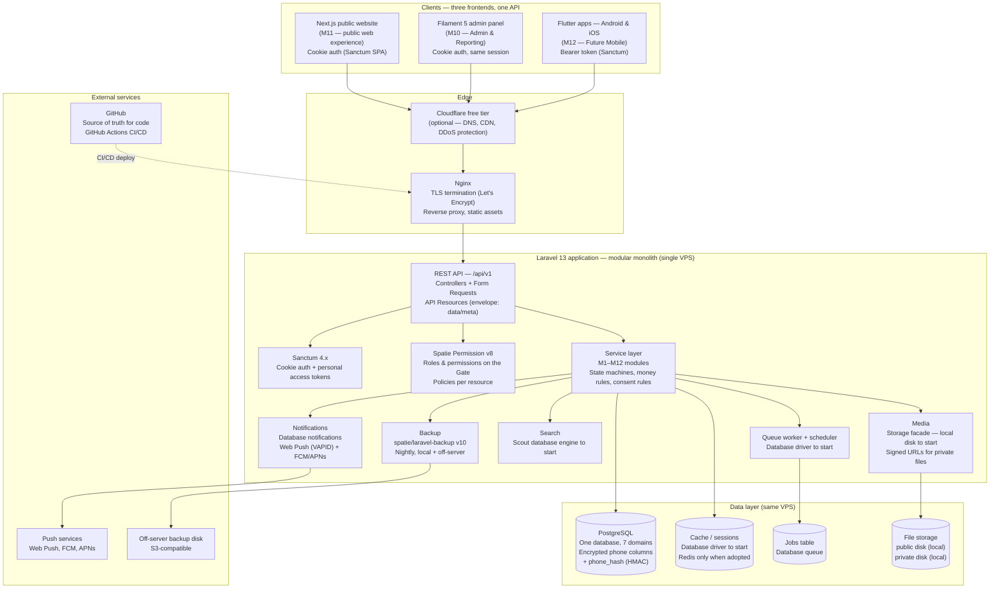

# System Architecture

| | |
|---|---|
| Document | Satanipara Community — Phase 0 Backend Blueprint, Diagrams |
| Status | **Planned** — planning only; no backend code or infrastructure exists yet |
| Sources | Decision Sheet (single source of truth); Audit Findings; Research Notes (verified 2026-11-14); Engineering Plan v1.1; Docs 07–12, ADRs 001–013 |

## 1. System architecture (Mermaid)

## 2. Layer-by-layer explanation

### 2.1 Clients — three frontends, one API

There are exactly three clients, and all three are clients of the same API (Doc 07, ADR-006):

- **Next.js public website (M11).** The public face of the organisation: home, directory, organisation, activities, expatriate support (wizard + tracking), blood donor search, news/notices/events/jobs, gallery, finance transparency, membership, login, member dashboard. It authenticates with Sanctum cookie authentication (same top-level domain as the API) and follows the Direction D design tokens and the Meridian system (Decision Sheet). It is built in Phase 7 (Doc 12).
- **Filament 5 admin panel (M10).** The administration surface specified in Doc 09. It runs inside the Laravel application (same process, same session authentication) but it is a *client of the same policies*: a helper opening the panel sees only expatriate operations, because the policies say so — not because a menu item is hidden. Built in Phase 8, after separate approval (Doc 12).
- **Flutter apps — Android & iOS (M12, Future Mobile).** Member-facing apps authenticating with Sanctum personal access tokens. They do not exist yet and are not built in this programme's website phases; when they are built, they consume the same versioned API and need no backend changes beyond additive endpoints (Doc 07 §13).

No client talks to the database. No business logic lives in a frontend. A fact that changes in the admin panel is visible on the website and in the app because all three read it from the same place.

### 2.2 Edge — Cloudflare and Nginx

- **Cloudflare free tier (optional).** DNS, CDN caching of public assets, and basic DDoS protection (Doc 11 §3). The system must work correctly without it. If it is enabled, the trusted-proxy configuration must be set correctly so the real client IP reaches the application — rate limiting (Doc 07 §9) depends on it.
- **Nginx.** TLS termination (Let's Encrypt, auto-renewal), HTTP → HTTPS redirect, static-asset serving, and reverse proxy to the Laravel application. Security headers (Doc 08 §4.3) are set at this layer or in middleware.

### 2.3 Backend — the Laravel 13 modular monolith

One Laravel 13 application (`^13.0`, PHP 8.4/8.5 — ADR-001, ADR-002) containing twelve modules (M1–M12, per Engineering Plan v1.1 §6). "Modular monolith" means: one deployable application, with explicit module boundaries inside it — not microservices. The modules are:

| Module | Name | Main API surface |
|---|---|---|
| M1 | Identity & Membership | Auth, registration/approval, profiles, users |
| M2 | Community Profile | Directory, stats, infrastructure |
| M3 | Organisation | History, constitution, committee |
| M4 | Annual Activities | Activities |
| M5 | Expatriate Support | Requests, assignment, transitions, expenses, tracking |
| M6 | Blood Donor | Donors, blood requests, consent |
| M7 | Content | News, notices, events, jobs, gallery, FAQ |
| M8 | Finance | Ledger, approvals, publishing, reversals, reports |
| M9 | Notifications | In-app, Web Push, device registration |
| M10 | Admin & Reporting | Filament panel, audit logs, reports, settings |
| M11 | Public Web Experience | The Next.js website (a client, not a backend module) |
| M12 | Mobile App | The Flutter apps (a client, not a backend module) |

Inside the application, the layers are:

- **REST API (`/api/v1`).** Controllers are thin: they validate (Form Requests), authorise (policies), call a service, and return an API Resource in the `{"data","meta"}` envelope (Doc 07).
- **Sanctum 4.x (ADR-004).** Cookie auth for the first-party SPA and the Filament panel; bearer tokens for mobile. Token expiry is configured; pruning is scheduled.
- **Spatie Permission v8 (ADR-005).** Roles and permissions in the database, registered on the Gate. Phase 1 roles: `super-admin` and `expatriate-helper` only.
- **Service layer.** Business logic lives in service classes (one per aggregate). Controllers never contain a state-transition rule or a money calculation (Doc 10 §1.2). The service layer enforces the expatriate state machine, the finance immutability/reversal rule, the donor-consent rule, and server-side computation of totals.
- **Notifications.** Database notifications are the reliable record; Web Push (VAPID) and FCM/APNs are delivery channels on top (Doc 07 §12). A new expatriate request notifies the Super Admin and all Helpers.
- **Queue worker + scheduler.** Database driver to start (ADR-008); the worker runs under supervision, never `queue:listen` in production. The scheduler runs the nightly backup, token pruning, and cleanup.
- **Search.** Scout `database` engine to start (ADR-010); Meilisearch only if Bengali search quality demonstrably fails.
- **Media.** All file access through the Storage facade; local disk to start, S3-compatible later (ADR-007). Private files are served through controllers with signed, time-limited URLs.
- **Backup.** spatie/laravel-backup v10, nightly, to local + one off-server S3-compatible disk, with a mandatory restore test (ADR-013).

### 2.4 Data layer — one database

- **PostgreSQL** (ADR-003, Recommended pending hosting confirmation) is the single database for all seven data domains (the plan's 38 tables — Engineering Plan v1.1). One database, not one per module: the modules share it, and cross-module queries (e.g. the overview dashboard, the reports) are ordinary joins, not distributed transactions.
- **Encrypted phone columns + `phone_hash` (HMAC).** Phone numbers and beneficiary-identifying fields are encrypted at the application layer; a keyed HMAC hash of the normalised phone is stored alongside for uniqueness checks and lookups, because an encrypted value cannot be searched (Doc 08 §6.2).
- **Money** is `decimal(12,2)` in BDT, never float (Decision Sheet).
- **Cache and sessions** are on the database driver to start (ADR-009); Redis only when adopted, at which point the cache moves to Redis and sessions stay on the database.
- **Jobs** live in the database queue tables (ADR-008).
- **File storage** is the local `public` disk (public media) and a non-public local disk (private files), both behind the Storage facade (ADR-007).

### 2.5 External services

- **Push services** (Web Push, FCM, APNs) deliver notifications to browsers and phones. Credentials are server-side only (Doc 07 §12).
- **Off-server backup disk** (S3-compatible) receives the second copy of every nightly backup (ADR-013). It is the copy that saves the organisation if the VPS is lost.
- **GitHub** is the source of truth for code. GitHub Actions runs the gates, deploys staging automatically, and deploys production only on manual approval with a pre-deploy backup (Doc 11 §4).

## 3. Data flow — a request through the system

**Public read (e.g. viewing the directory):**

1. The browser/app asks Cloudflare → Nginx → the API (`GET /api/v1/directory?search=…`).
2. The API route is public, so no authentication is required — but the query is still scoped: only published, consented entries are selected.
3. The service queries PostgreSQL (Scout database engine for the search), the API Resource shapes the response, and the client renders it. No phone numbers are in the response.

**Authenticated write (e.g. a helper advancing a request):**

1. The request carries the session cookie (web) or bearer token (mobile). Sanctum authenticates it.
2. The policy checks: is this user a helper, and is this request assigned to them (or claimable)? If not, 403.
3. The Form Request validates the body (new status is a valid transition; note ≥ 10 characters).
4. The service performs the transition inside a database transaction: status updated, history row written (actor, timestamp, note), notification rows created for the member (and the Super Admin where relevant), and the job to deliver the push notification dispatched to the queue.
5. The API returns the updated request in the envelope. The audit log records the transition.

**Public submission (e.g. a new expatriate request):**

1. The public form posts to `POST /api/v1/expatriate-requests` (rate-limited per IP and per phone — Doc 07 §9).
2. The server validates every prototype rule again (Doc 07 §7), generates a unique ID under a database uniqueness constraint (the prototype's random IDs could collide — Audit Findings §8 item 10), and stamps the server time (the prototype hardcoded the creation date).
3. The request is stored with status `pending`; notifications are created for the Super Admin and all Helpers; the response returns the new Request ID.

## 4. The single-source-of-truth principle

The prototype duplicated the same fact in several places: the demo request `EXP-2026-1052` rendered in four places, finance 2026 rows in two, activities/news in two, gallery images in three, and the policy copy (no service charge / 999 / ERT 3–5) re-typed as inline HTML in several places (Audit Findings §4). Each duplication was a chance for the copies to disagree — and they did (the three prototype files disagreed about the demo request's status).

The architecture prevents this by construction:

- **Each fact is stored once** in PostgreSQL and **exposed once** by the API. Clients render it wherever it is needed; they do not keep their own copies.
- **Policy copy is data, not markup:** the public settings endpoint (`GET /api/v1/public/settings`, Doc 07 P3) is the single source for the no-service-charge statement, the 999 disclaimer, and the ERT size.
- **Statistics are computed, never hand-typed:** counts and totals are aggregated from the data at request time (per Engineering Plan v1.1). Unverified figures are returned as `{"status": "updating"}`, never invented.
- **The API is the only writer:** no client writes to the database, no client computes a total the server will trust, and no client-side state is treated as authoritative. The prototype's in-memory `state` object (Audit Findings §2.5) — which vanished on every reload — has no counterpart in the production system.
